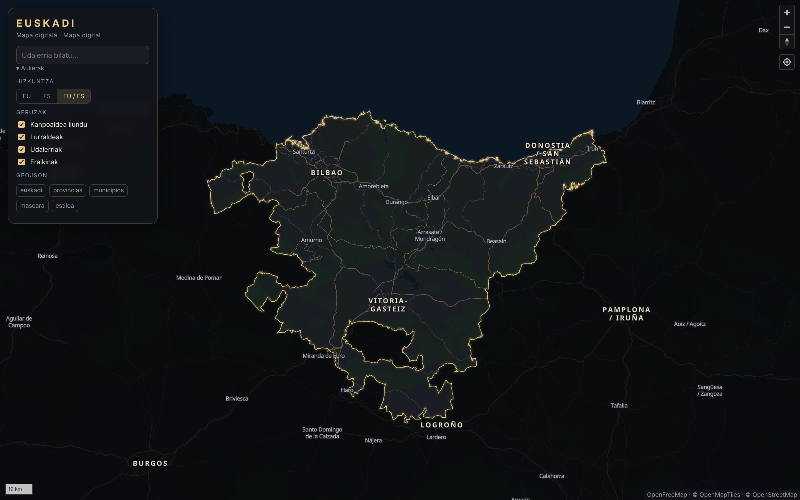
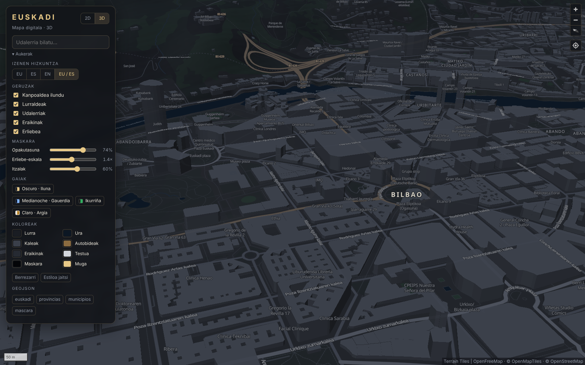
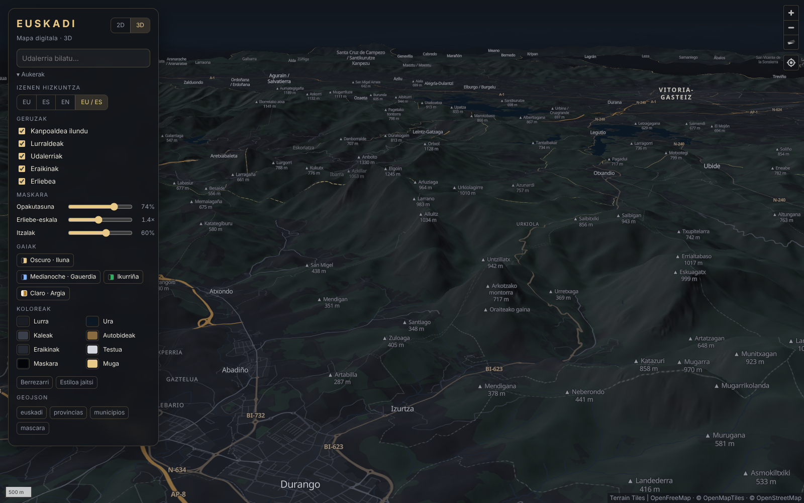
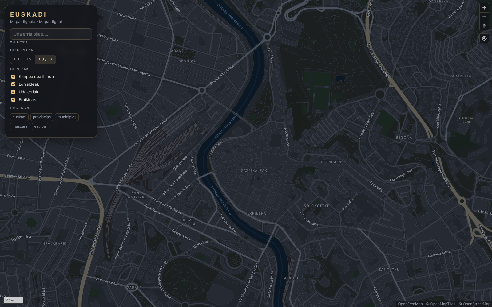
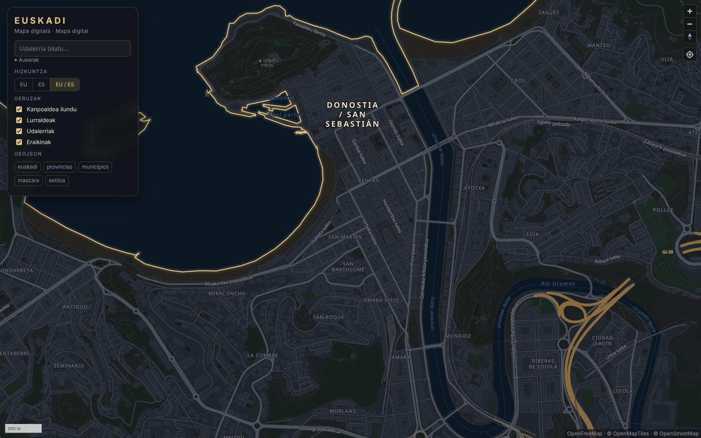
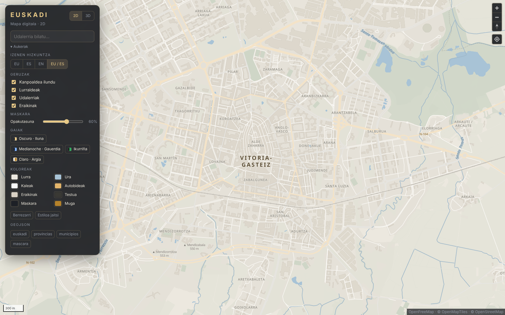
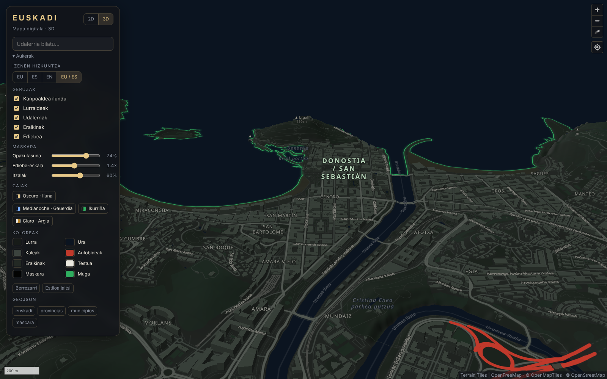
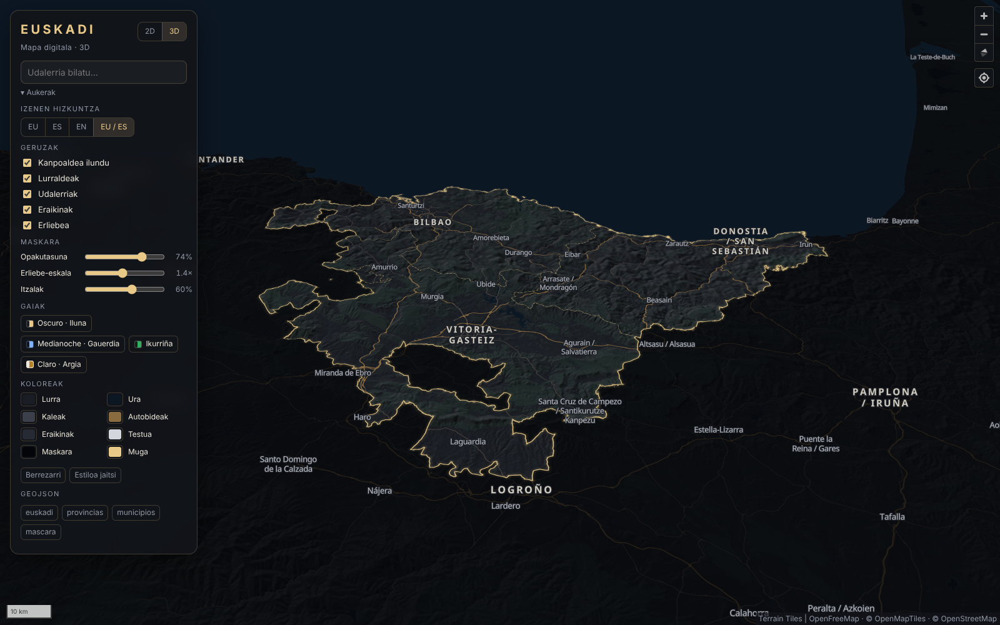

# Euskadi · Digital Map

**[English](#english) · [Euskara](#euskara)**

A dark, elegant digital map of the Basque Country (Euskadi) showing **every street** from OpenStreetMap, in **2D and 3D**. Land outside Euskadi is darkened and the sea is not. You can change the mask and the colours from the map itself.

**➜ 2D map:** https://mapa.ortzigar.org
**➜ 3D map:** https://mapa.ortzigar.org/3d.html



| 3D · Bilbao | 3D · Anboto / Urkiola |
|---|---|
|  |  |
| **2D · Bilbao** | **2D · Donostia** |
|  |  |
| **Theme “Claro” · Vitoria-Gasteiz** | **Theme “Ikurriña” · 3D Donostia** |
|  |  |



---

## English

### Features

- **2D** (`index.html`) and **3D** (`3d.html`) versions. You can switch between them with the 2D / 3D buttons, and the map keeps its position.
- **Every street, building and place name** from OpenStreetMap, using free vector tiles from [OpenFreeMap](https://openfreemap.org) (no API key).
- **3D mode**: real terrain elevation, hillshading, extruded buildings with real heights, and fog on the horizon.
- **Outside mask**: neighbouring land is darkened (Cantabria, Burgos, La Rioja, Navarre, Iparralde…). This includes the Treviño and Villaverde de Trucios enclaves. The sea is never darkened.
- **Customise from the map panel**:
  - Mask colour and opacity, and an on/off switch
  - Colours for land, water, streets, motorways, buildings, text, mask and border
  - Four themes: *Oscuro* (dark), *Medianoche* (midnight), *Ikurriña* and *Claro* (light)
  - 3D: terrain scale and hillshade strength
  - **Download style** saves your customised style as a MapLibre JSON file
  - Your settings are saved in your browser
- Municipality **search**. Click a municipality to see its province, population and INE code.
- Label language: **EU**, **ES**, **EN** or **EU / ES** (the official, often bilingual, name).
- Shareable URLs: the position is stored in the `#hash`. `?tema=claro` picks a theme and `?lang=en` picks a language.

### GeoJSON files

GitHub shows any `.geojson` file as an interactive map, so you can preview these directly in the repo.

| File | Contents |
|---|---|
| [`data/euskadi.geojson`](data/euskadi.geojson) | Boundary of the Basque Autonomous Community |
| [`data/provincias.geojson`](data/provincias.geojson) | Araba/Álava, Bizkaia and Gipuzkoa |
| [`data/municipios.geojson`](data/municipios.geojson) | All 252 municipalities and 9 *partzuergoak* (communal lands) |
| [`data/mascara.geojson`](data/mascara.geojson) | Mask: the surrounding land that is **not** Euskadi (sea excluded) |
| [`estilo/euskadi-oscuro.json`](estilo/euskadi-oscuro.json) | Dark MapLibre GL style |

Municipality properties:

```json
{ "nombre": "Agurain / Salvatierra", "izena_eu": "Agurain", "nombre_es": "Salvatierra",
  "ine": "01051", "poblacion": "5173", "provincia": "Araba / Álava",
  "tipo": "municipio", "admin_level": 8, "osm_id": 340918, "wikidata": "Q398698" }
```

`tipo` is either `municipio` or `partzuergoa` (communal land that belongs to no municipality, such as Enirio-Aralar).
Coordinates are in WGS84 (EPSG:4326).

### Use it in your project

**MapLibre GL JS** (the same map as the website):

```html
<link rel="stylesheet" href="https://unpkg.com/maplibre-gl@5.24.0/dist/maplibre-gl.css">
<script src="https://unpkg.com/maplibre-gl@5.24.0/dist/maplibre-gl.js"></script>
<div id="map" style="height:100vh"></div>
<script>
  const BASE = "https://cdn.jsdelivr.net/gh/ortzigaraio/Euskadi-Mapa-digital-@main/";
  fetch(BASE + "estilo/euskadi-oscuro.json").then(r => r.json()).then(style => {
    for (const s of Object.values(style.sources))           // make data/*.geojson absolute
      if (s.type === "geojson") s.data = BASE + s.data;
    new maplibregl.Map({ container: "map", style, center: [-2.62, 43.04], zoom: 8.5 });
  });
</script>
```

Or copy `index.html`, `3d.html`, `css/`, `js/`, `estilo/` and `data/` to your own site.

**Leaflet** (just the mask and border, over any base map):

```js
const BASE = "https://cdn.jsdelivr.net/gh/ortzigaraio/Euskadi-Mapa-digital-@main/data/";
fetch(BASE + "mascara.geojson").then(r => r.json()).then(g =>
  L.geoJSON(g, { style: { stroke: false, fillColor: "#000", fillOpacity: 0.7 } }).addTo(map));
fetch(BASE + "euskadi.geojson").then(r => r.json()).then(g =>
  L.geoJSON(g, { style: { color: "#e8c987", weight: 2, fill: false } }).addTo(map));
```

**QGIS / Python**: drag the `.geojson` files into QGIS, or use `geopandas.read_file(...)`.

### Run locally

Start `python3 -m http.server 8000` in the repo folder and open http://localhost:8000.

### Rebuild the data

```bash
pip install shapely
python3 scripts/build_data.py      # GeoJSON from OpenStreetMap
node scripts/capturas.mjs          # preview images in img/ (needs Playwright and a local server)
```

The mask is built from the neighbouring provinces and regions. Their boundaries follow the coastline, so the sea is never included. Beyond that area the viewer darkens everything and then repaints the ocean on top.

### Project layout

```
index.html            2D viewer
3d.html               3D viewer
js/mapa.js            shared viewer code (themes, colours, mask, search, 3D)
css/mapa.css          viewer styles
estilo/               MapLibre style
data/                 GeoJSON
scripts/              data and screenshot generators
img/                  previews
```

### Licences

- Code and style: [MIT](LICENSE).
- Data (GeoJSON and tiles): © [OpenStreetMap](https://www.openstreetmap.org/copyright) contributors, [ODbL](https://opendatacommons.org/licenses/odbl/). If you use it, credit “© OpenStreetMap contributors”.
- Tiles: [OpenFreeMap](https://openfreemap.org) · [OpenMapTiles](https://www.openmaptiles.org/).
- Elevation (3D): [Terrain Tiles](https://github.com/tilezen/joerd/blob/master/docs/attribution.md) (Mapzen / AWS Open Data).

---

## Euskara

Euskadiko mapa digital iluna eta dotorea, OpenStreetMap-eko **kale guztiekin**, **2Dn eta 3Dn**. Euskadikoa ez den lurra ilunduta dago, eta itsasoa ez. Maskara eta koloreak mapatik bertatik alda daitezke.

**➜ 2D mapa:** https://mapa.ortzigar.org
**➜ 3D mapa:** https://mapa.ortzigar.org/3d.html

### Ezaugarriak

- **2D** (`index.html`) eta **3D** (`3d.html`) bertsioak. 2D / 3D botoiekin batetik bestera pasa zaitezke, eta mapak bere kokapena gordetzen du.
- OpenStreetMap-eko **kale, eraikin eta leku-izen guztiak**, [OpenFreeMap](https://openfreemap.org)-en tesela bektorialekin (doan, API gakorik gabe).
- **3D modua**: benetako erliebea, itzalak, eraikinak beren benetako altuerarekin eta lainoa zeruertzean.
- **Kanpoko maskara**: inguruko lurrak ilunduta daude (Kantabria, Burgos, Errioxa, Nafarroa, Iparraldea…), Trebiñu eta Villaverde Turtzioz enklabeak barne. Itsasoa ez da inoiz iluntzen.
- **Panelean pertsonalizatu**:
  - Maskararen kolorea eta opakutasuna, eta piztu/itzali
  - Lurraren, uraren, kaleen, autobideen, eraikinen, testuaren, maskararen eta mugaren koloreak
  - Lau gai: *Iluna*, *Gauerdia*, *Ikurriña* eta *Argia*
  - 3D: erliebe-eskala eta itzalen indarra
  - **Estiloa jaitsi** botoiak zure estiloa MapLibre JSON fitxategi gisa gordetzen du
  - Zure ezarpenak nabigatzailean gordetzen dira
- Udalerri-**bilatzailea**. Udalerri batean klik eginez gero, lurraldea, biztanleak eta INE kodea ikusten dira.
- Izenen hizkuntza: **EU**, **ES**, **EN** edo **EU / ES** (izen ofiziala, askotan elebiduna).
- URLak partekatzeko modukoak dira: kokapena `#hash`-ean gordetzen da. `?tema=claro` gaia aukeratzen du eta `?lang=eu` hizkuntza.

### GeoJSON fitxategiak

GitHub-ek edozein `.geojson` mapa interaktibo gisa erakusten du, beraz zuzenean ikus daitezke biltegian.

| Fitxategia | Edukia |
|---|---|
| [`data/euskadi.geojson`](data/euskadi.geojson) | Euskal Autonomia Erkidegoaren muga |
| [`data/provincias.geojson`](data/provincias.geojson) | Araba, Bizkaia eta Gipuzkoa |
| [`data/municipios.geojson`](data/municipios.geojson) | 252 udalerriak eta 9 partzuergo (INE kodea, biztanleak, izena euskaraz eta gaztelaniaz) |
| [`data/mascara.geojson`](data/mascara.geojson) | Euskadikoa **ez** den inguruko lurra (itsasoa kanpo) |
| [`estilo/euskadi-oscuro.json`](estilo/euskadi-oscuro.json) | MapLibre GL estilo iluna |

`tipo` eremuak `municipio` edo `partzuergoa` balioa du. Partzuergoak inongo udalerritakoak ez diren lur komunalak dira, Enirio-Aralar adibidez.
Koordenatuak WGS84 sisteman daude (EPSG:4326).

### Zure proiektuan erabili

Ikusi goiko [English](#use-it-in-your-project) ataleko MapLibre eta Leaflet adibideak: berdin balio dute. Edo kopiatu `index.html`, `3d.html`, `css/`, `js/`, `estilo/` eta `data/` zure webgunera.

### Lokalean probatu

Abiarazi `python3 -m http.server 8000` biltegiaren karpetan eta ireki http://localhost:8000.

### Datuak berriro sortu

```bash
pip install shapely
python3 scripts/build_data.py      # GeoJSON-ak OpenStreetMap-etik
node scripts/capturas.mjs          # img/ karpetako irudiak
```

### Lizentziak

- Kodea eta estiloa: [MIT](LICENSE).
- Datuak: © [OpenStreetMap](https://www.openstreetmap.org/copyright)-en laguntzaileak, [ODbL](https://opendatacommons.org/licenses/odbl/). Erabiltzen badituzu, aipatu «© OpenStreetMap contributors».
- Teselak: [OpenFreeMap](https://openfreemap.org) · [OpenMapTiles](https://www.openmaptiles.org/). Erliebea: [Terrain Tiles](https://github.com/tilezen/joerd/blob/master/docs/attribution.md).
