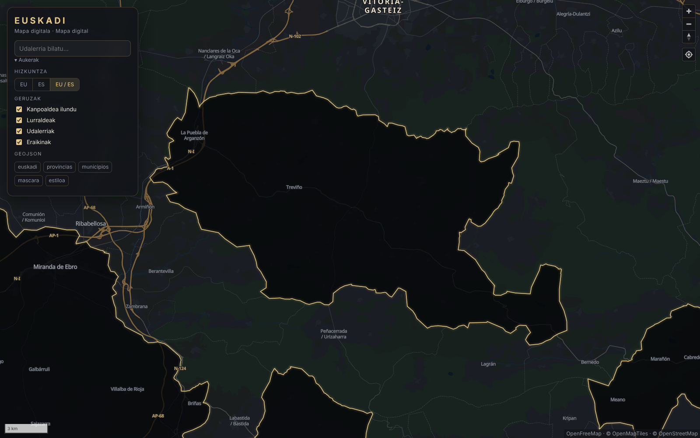

# Euskadi · Mapa digital

Mapa digital de Euskadi, oscuro y elegante, con **todas las calles** (OpenStreetMap) y el exterior oscurecido: la tierra que no es Euskadi queda en sombra, el mar no.
Incluye los **GeoJSON** de Euskadi, sus tres territorios y sus municipios, listos para usar en cualquier proyecto.

**➜ Mapa en vivo:** https://ortzigaraio.github.io/Euskadi-Mapa-digital-/


| Bilbao | Donostia |
|---|---|
|  |  |

El enclave de Treviño (Burgos) también queda oscurecido:



## Qué hay en el repo

| Archivo | Contenido |
|---|---|
| [`data/euskadi.geojson`](data/euskadi.geojson) | Contorno de la Comunidad Autónoma de Euskadi |
| [`data/provincias.geojson`](data/provincias.geojson) | Araba/Álava, Bizkaia y Gipuzkoa |
| [`data/municipios.geojson`](data/municipios.geojson) | Municipios (con código INE, población, nombre en euskera y castellano) y partzuergoak/facerías |
| [`data/mascara.geojson`](data/mascara.geojson) | Máscara: la tierra de alrededor que **no** es Euskadi (el mar no está incluido) |
| [`estilo/euskadi-oscuro.json`](estilo/euskadi-oscuro.json) | Estilo oscuro para MapLibre GL (calles, edificios, etiquetas, máscara y borde) |
| [`index.html`](index.html) | Visor web: buscador de municipios, idioma EU / ES / EU·ES, capas |
| [`scripts/build_data.py`](scripts/build_data.py) | Regenera los GeoJSON desde OpenStreetMap |
| [`scripts/capturas.mjs`](scripts/capturas.mjs) | Regenera las imágenes de `img/` |

Puedes abrir cualquier `.geojson` en GitHub para verlo en el mapa interactivo de GitHub.

Propiedades de cada municipio:

```json
{ "nombre": "Agurain / Salvatierra", "izena_eu": "Agurain", "nombre_es": "Salvatierra",
  "ine": "01051", "poblacion": "5173", "provincia": "Araba / Álava",
  "tipo": "municipio", "admin_level": 8, "osm_id": 340918, "wikidata": "Q398698" }
```

`tipo` vale `municipio` o `partzuergoa` (montes comunales que no pertenecen a ningún municipio, como Enirio-Aralar).

## Usarlo en tu proyecto

### MapLibre GL JS (el mismo mapa que la web)

```html
<link rel="stylesheet" href="https://unpkg.com/maplibre-gl@5.24.0/dist/maplibre-gl.css">
<script src="https://unpkg.com/maplibre-gl@5.24.0/dist/maplibre-gl.js"></script>
<div id="map" style="height:100vh"></div>
<script>
  const BASE = "https://cdn.jsdelivr.net/gh/ortzigaraio/Euskadi-Mapa-digital-@main/";
  fetch(BASE + "estilo/euskadi-oscuro.json").then(r => r.json()).then(style => {
    // Las rutas data/*.geojson del estilo son relativas: se hacen absolutas
    for (const s of Object.values(style.sources))
      if (s.type === "geojson") s.data = BASE + s.data;
    new maplibregl.Map({ container: "map", style, center: [-2.62, 43.04], zoom: 8.5 });
  });
</script>
```

Las teselas vectoriales vienen de [OpenFreeMap](https://openfreemap.org): gratis, sin clave de API y sin límite de uso.

### Leaflet (solo la máscara y el borde, sobre tu mapa base)

```js
const BASE = "https://cdn.jsdelivr.net/gh/ortzigaraio/Euskadi-Mapa-digital-@main/data/";
fetch(BASE + "mascara.geojson").then(r => r.json()).then(g =>
  L.geoJSON(g, { style: { stroke: false, fillColor: "#000", fillOpacity: 0.7 } }).addTo(map));
fetch(BASE + "euskadi.geojson").then(r => r.json()).then(g =>
  L.geoJSON(g, { style: { color: "#e8c987", weight: 2, fill: false } }).addTo(map));
```

### Python / QGIS

Los `.geojson` se abren directamente en QGIS (arrastrar y soltar) o con `geopandas.read_file(...)`. Coordenadas en WGS84 (EPSG:4326).

## Publicar la web en GitHub Pages

1. **Settings → Pages**
2. *Source*: **Deploy from a branch** · *Branch*: `main` · carpeta `/ (root)` → **Save**
3. En un par de minutos estará en `https://<usuario>.github.io/Euskadi-Mapa-digital-/`

Para probarlo en local: `python3 -m http.server 8000` y abrir http://localhost:8000.

## Regenerar los datos

```bash
pip install shapely
python3 scripts/build_data.py
```

Descarga los límites oficiales de OpenStreetMap (API de OSM, polygons.openstreetmap.fr y Overpass) y genera los cuatro GeoJSON.
La máscara se construye con las provincias/regiones vecinas (Cantabria, Burgos, La Rioja, Navarra, Pyrénées-Atlantiques, Landes…), cuyos límites siguen la costa, de modo que el mar nunca se oscurece.
El visor limita el desplazamiento a la zona que cubre la máscara.

## Licencias

- Código y estilo: [MIT](LICENSE).
- Datos (GeoJSON y teselas): © colaboradores de [OpenStreetMap](https://www.openstreetmap.org/copyright), licencia [ODbL](https://opendatacommons.org/licenses/odbl/). Si los usas, cita «© OpenStreetMap contributors».
- Teselas: [OpenFreeMap](https://openfreemap.org) · [OpenMapTiles](https://www.openmaptiles.org/).

---

## Euskaraz

Euskadiko mapa digitala, ilun eta dotorea, **kale guztiekin** (OpenStreetMap). Euskadi ez den lurra ilunduta dago; itsasoa ez.
Euskadiren, hiru lurraldeen eta udalerri guztien **GeoJSON** fitxategiak daude `data/` karpetan, edozein proiektutan erabiltzeko.

- Mapa zuzenean: https://ortzigaraio.github.io/Euskadi-Mapa-digital-/
- `data/euskadi.geojson` – Euskadiko muga
- `data/provincias.geojson` – Araba, Bizkaia eta Gipuzkoa
- `data/municipios.geojson` – udalerriak (INE kodea, biztanleak, izena euskaraz eta gaztelaniaz) eta partzuergoak
- `data/mascara.geojson` – Euskadi ez den inguruko lurra (itsasoa kanpo)
- `estilo/euskadi-oscuro.json` – MapLibre GL estilo iluna

Datuak © OpenStreetMap-en laguntzaileak (ODbL). Kodea: MIT.
